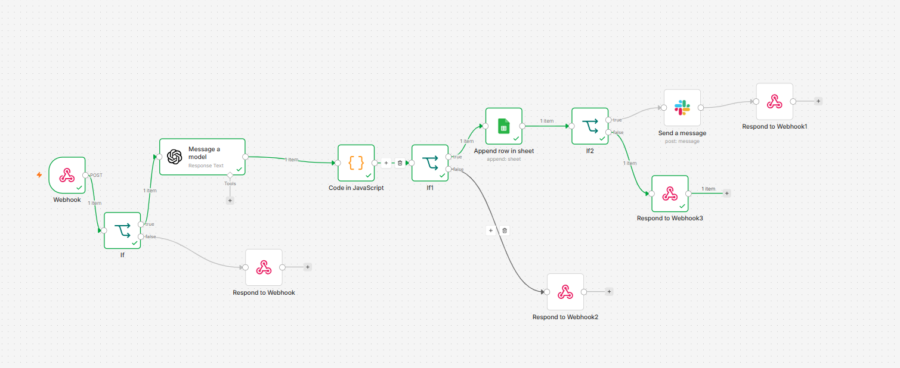
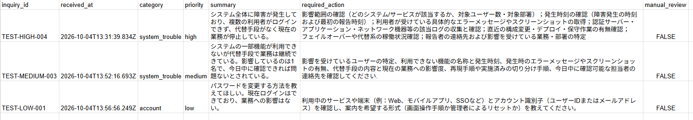
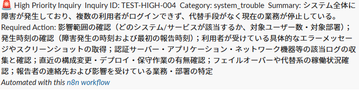
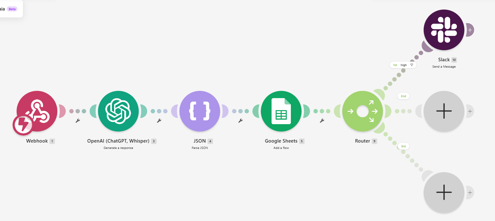
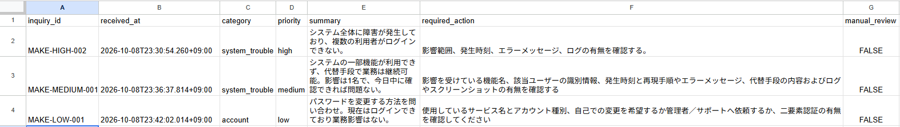
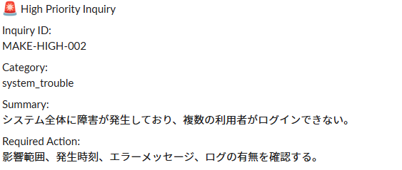

# AI Workflow Automation

n8n / Make / OpenAI API を使い、問い合わせ内容をAIで分類・要約し、優先度に応じて記録・通知する業務自動化PoCです。

問い合わせ内容の確認、分類・要約、優先度判断、Google Sheetsへの転記、高優先度の問い合わせのみのSlack通知にかかる手作業を減らすことを目的としています。

同じ業務要件をn8nとMakeの両方で実装し、構成を比較しています。n8n版ではAI出力の検証と処理の制御を重視し、Make版ではGUI中心にシンプルに再実装しています。

以下のWorkflowからn8n Workflowまではn8n版の説明です。Make版は「Make Version」で紹介します。

## Workflow

```text
Webhook
└─ If (Input Validation)
   ├─ false → Respond to Webhook (Error Response)
   └─ true → Message a model (OpenAI)
              ↓
            Code in JavaScript (JSON Parse / Validation)
              ↓
            If1 (valid)
            ├─ false → Respond to Webhook2 (manual_review Response)
            └─ true → Append row in sheet (Google Sheets)
                        ↓
                      If2 (Priority Check)
                      ├─ high → Send a message (Slack)
                      │           ↓
                      │         Respond to Webhook1
                      └─ medium / low → Respond to Webhook3
```

必須入力（`inquiry_id` と `message`）を確認し、OpenAIで問い合わせを分類・要約します。AI出力をJSONとして解析・検証し、検証に成功した結果をGoogle Sheetsに保存します。`high` の場合だけSlackへ通知し、`medium` と `low` は通知しません。入力不正、AI出力不正はそれぞれ専用のWebhookレスポンスを返します。

## Implemented Features

- Webhookによる問い合わせ受付
- `inquiry_id` と `message` の必須入力チェック
- OpenAIによるカテゴリ分類・優先度判定・要約
- AI出力のJSONパース
- `category` / `priority` の許可値検証
- `summary` / `required_action` が空でない文字列であることを検証
- 不正なAI出力を検出すると `manual_review` ステータスをWebhookレスポンスとして返します。人による確認・承認、担当者への通知、確認待ちキューへの登録は未実装です。
- Google Sheetsへの分析結果保存
- `high` priority のみSlack通知
- 正常系 / 入力不正 / AI出力不正の分岐とWebhookレスポンス

## Screenshots

### Workflow Overview

n8nで構築した問い合わせ一次整理ワークフローです。



### Google Sheets Result

AIによる分類・要約結果をGoogle Sheetsへ保存します。
high / medium / low の3パターンを確認しています。



### Slack Notification

`priority = high` の問い合わせのみSlackへ通知します。



## Safety Design

- AI出力をそのまま後続処理へ渡さず、JSONとして解析可能か確認
- `category` / `priority` が許可値に含まれるか検証
- `summary` / `required_action` の必須・型チェック（空でない文字列であること）
- 不正なAI出力を検出すると `manual_review` ステータスをWebhookレスポンスとして返します。人による確認・承認、担当者への通知、確認待ちキューへの登録は未実装です。
- 認証情報はn8n Credentialsで管理し、GitHubへ含めない

## Test Cases

以下はn8n版のテストです。`Confirmed` はワークフロー全体の実行確認を示します。`Partial` は一部の入力のみ確認済み、`No` は未確認です。期待結果と確認済みの範囲を分けて記載しています。

| Case | 入力・条件 | 期待結果 | Confirmed | 確認済みの範囲・根拠 |
| --- | --- | --- | --- | --- |
| High Priority | 複数ユーザーに影響、代替手段なし、業務停止 | Google Sheetsへ保存、Slack通知あり、`notification_sent = true` | Yes | 実行記録 #34：`priority = high`、Sheets・Slack・正常レスポンスの各ノードを通過し正常終了 |
| Medium Priority | 一部機能に問題、代替手段あり、業務継続可能 | Google Sheetsへ保存、Slack通知なし、`notification_sent = false` | Yes | 実行記録 #36：`priority = medium`、Sheetsから通知なしの正常レスポンスへ進み正常終了 |
| Low Priority | 業務影響や緊急性のない操作方法等の問い合わせ | Google Sheetsへ保存、Slack通知なし、`notification_sent = false` | Yes | 実行記録 #37：`priority = low`、Sheetsから通知なしの正常レスポンスへ進み正常終了 |
| Invalid Input | `inquiry_id` または `message` が未入力 | HTTP 400と必須入力エラーのWebhookレスポンス | No | 該当する実行記録は未確認 |
| Invalid JSON | AI出力がJSONとして解析できない | Codeで `valid = false` / `manual_review = true`、`reason = invalid_json`。Webhookで `status = manual_review` | No | 該当する実行記録は未確認 |
| Invalid Schema / Value | AI出力が `null`、配列、プリミティブ値、または不正な `category` | 例外なくCodeで `valid = false` / `manual_review = true`、`reason = invalid_schema_or_value`。If1のfalse側からWebhookで `status = manual_review` | Partial | `null` は実行記録 #39で `analysis = null`、If1のfalse側からRespond to Webhook2まで到達し正常終了。配列・プリミティブ値・不正categoryはCode単体で確認済み、ワークフロー全体は未確認 |

## Tech Stack

- n8n
- OpenAI API
- Docker
- Google Sheets
- Slack

## Setup

### 1. n8nを起動

DockerとDocker Composeを利用できる環境で、リポジトリのルートから実行します。

```powershell
docker compose up -d
docker compose ps
```

ブラウザで `http://localhost:5678` を開きます。初回起動時に画面の案内に従ってアカウントを設定します。Composeでは `./n8n_data` にデータを保存します。イメージはリポジトリの `docker-compose.yml` の指定を使用します（固定バージョンの指定はありません）。

### 2. 公開用ワークフローをインポート

n8nでワークフローのメニューから **Import from File** を選び、`n8n/inquiry-triage-workflow.public.json` を読み込みます。公開用JSONの認証・接続先はプレースホルダーのため、以下の手動設定が必要です。

### 3. Credentialsと接続先を設定

n8nで自分のOpenAI / Google Sheets / SlackのCredentialsを作成し、各ノードで選択します。認証値はn8nのCredentialsに登録してください。

| ノード | 必要な設定 |
| --- | --- |
| Message a model | OpenAI APIのCredential。モデルはJSONで指定されている `gpt-5-mini` を使用できることを確認 |
| Append row in sheet | Google Sheets OAuth2のCredential。書き込み可能な自分のスプレッドシートとシートを選択 |
| Send a message | Slack OAuth2のCredential。認証したアプリが投稿できる自分のチャンネルを選択 |

Google Sheetsの対象シートの1行目に、次の列名を設定します。

```text
inquiry_id
received_at
category
priority
summary
required_action
manual_review
```

接続先の選択後、Append row in sheetの列マッピングがこれらの列に対応していることを確認します。

### 4. Webhookへサンプルを送信

サンプル入力は次のとおりです。

```json
{
  "inquiry_id": "SAMPLE-001",
  "message": "システムの一部機能が利用できませんが、代替手段で業務は継続できています。"
}
```

Webhookノードに表示される **Test URL** をコピーし、ワークフロー全体の **Execute workflow** で待受を開始します。その後、PowerShellで次を実行してください。URLは実行時に入力するため、このREADMEには実環境のWebhook URLを記載していません。

```powershell
$webhookUrl = Read-Host "WebhookノードのTest URLを入力"

$json = @{
    inquiry_id = "SAMPLE-001"
    message = "システムの一部機能が利用できませんが、代替手段で業務は継続できています。"
} | ConvertTo-Json

$body = [System.Text.Encoding]::UTF8.GetBytes($json)

Invoke-RestMethod `
    -Method Post `
    -Uri $webhookUrl `
    -ContentType "application/json; charset=utf-8" `
    -Body $body
```

実行結果とGoogle Sheetsへの保存を確認します。AIの判定結果は入力や実行によって異なり、検証成功かつ `high` の場合のみSlack通知されます。検証失敗時は `manual_review` ステータスを返します。

継続利用する場合は設定済みのワークフローを保存・公開（有効化）し、Webhookノードの **Production URL** を送信先に使用します。Test URLはテスト待受中に使用します。

インポートとWebhookの扱いは、[n8n公式のインポート手順](https://docs.n8n.io/workflows/export-import/)と[Webhookの説明](https://docs.n8n.io/integrations/builtin/core-nodes/n8n-nodes-base.webhook/)も参照してください。

## n8n Workflow

`n8n/inquiry-triage-workflow.public.json` は、サニタイズ済みの公開用ワークフローです。インポートと認証・接続先の設定は、上記のSetupを参照してください。

## Make Version

Makeを使って、同じ問い合わせ一次整理フローをローコードで再実装しています。

### Workflow

```text
Webhook
→ OpenAI
→ Parse JSON
→ Google Sheets
→ Router
   └ Filter: priority = high
        → Slack
```

### Implemented Features

- Webhookによる問い合わせ受付
- OpenAIによるカテゴリ分類・優先度判定・要約
- Parse JSONによるAI出力の構造化
- Google Sheetsへの分析結果保存
- Router + Filterによるpriority判定
- `high` priority のみSlack通知
- high / medium / low の3パターンを動作確認

### Verified Behavior

| priority | Google Sheets保存 | Slack通知 |
| --- | --- | --- |
| high | あり | あり |
| medium | あり | なし |
| low | あり | なし |

### Tech Stack

- Make
- OpenAI API
- Google Sheets
- Slack

### Screenshots

#### Workflow Overview

Makeで構築した問い合わせ一次整理フローです。



#### Google Sheets Result

high / medium / low の3パターンをGoogle Sheetsへ保存しています。



#### Slack Notification

`priority = high` の問い合わせのみSlackへ通知します。



## n8n vs Make

両版とも、問い合わせの分類・優先度判定・要約、Google Sheetsへの保存、high priorityのみのSlack通知を実装しています。

- n8n版: 入力チェック、AI出力のJSON解析、`category` / `priority` の許可値検証、`summary` / `required_action` の必須・型チェック（空でない文字列であること）を実装しています。検証失敗時は `manual_review` ステータスをWebhookレスポンスとして返します。人による確認・承認、担当者への通知、確認待ちキューへの登録は未実装です。
- Make版: GUI中心で同じ業務フローをシンプルに再現しています。Parse JSONによる解析は行いますが、n8n版の必須項目・許可値の検証や、検証失敗時に `manual_review` ステータスを返す処理は実装していません。

## Example

n8n版・Make版に共通する入力と期待するAI出力の説明用サンプルです。実顧客情報や実データは使用していません。実際のAI出力は異なる場合があります。

### Input

```json
{
  "inquiry_id": "SAMPLE-001",
  "message": "システムの一部機能が利用できませんが、代替手段で業務は継続できています。"
}
```

### Expected AI Result

```json
{
  "category": "system_trouble",
  "priority": "medium",
  "summary": "システムの一部機能が利用できないが、代替手段で業務は継続できている。",
  "required_action": "利用できない機能、発生時刻、エラー内容などを確認する。"
}
```

## Status

PoC implemented.
